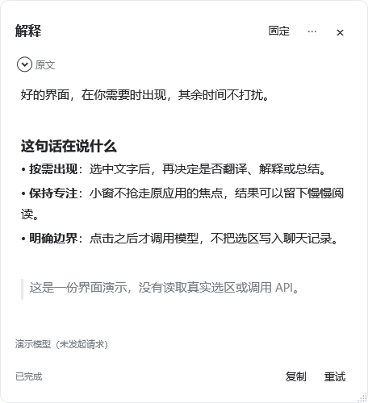
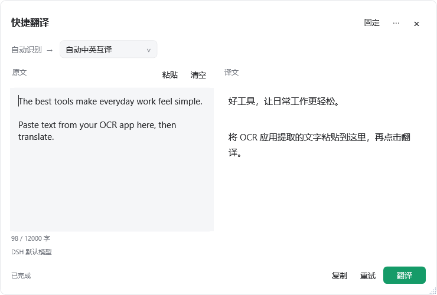

# DSH Selection Assistant · 划词助手

[](https://github.com/bjcdeshu/dsh-selection-assistant/actions/workflows/ci.yml)

**让常开的 DeepSeek Harness 顺便接管全局划词，不再为这一个功能多留一整套聊天软件。**

Windows 划词工具条：**翻译 / 解释 / 总结**，另有可输入、粘贴 OCR 文字的**快捷翻译**窗口。复用 Cherry Studio 所用的 MIT `selection-hook` 取词基础，界面、提示词和 DSH 集成独立实现。

> **开发预览版。** 当前目标是 Windows 10/11 + DSH Desktop **0.2.0-rc.2**。依赖版本刻意锁定，其他 DSH 版本需要验证。已接入真实宿主，三种模型操作完成，用户确认自动划词和译文正常。自动化测试不等于各类应用都兼容；详见[验证记录与资源实测](docs/VERIFICATION.md)。不宣称零进程或固定内存占用。

## 界面预览

以下截图由纯示例文字生成，没有真实选区、模型请求或私人数据。




[设置窗口预览](docs/images/settings.png)



[深色快捷翻译](docs/images/quick-dark.png)

## 设计

- 选中文字只弹工具条，**点击动作后才调用模型**。
- 非激活原生工具条不抢原窗口焦点；结果窗可选中文本、复制、停止、置顶、拖动和缩放。
- 通过 `ctx.llm.stream` 使用 DSH 已配置的模型；不复制 API Key，不启动完整 Agent，不开放文件/命令工具，不创建一堆“未分组”会话。
- 单次无历史请求，英文默认译成中文、明显中文默认译成英文；解释/总结默认中文，也可固定输出语言。96 种目标语言可按中文、英文或本地名称搜索，支持自定义语言；翻译质量取决于所选模型。
- 自定义三类提示词，支持 `{{targetLanguage}}`。显式独立模型或跟随 **DSH 全局默认模型**，不是跟随当前打开的会话。
- 首次加载处于暂停状态。用户在设置中勾选后才开始监听；托盘可暂停，`Ctrl+Alt+D` 可手动取词。
- `Ctrl+Alt+T` 或双击托盘打开快捷翻译。支持输入、粘贴、清空、目标语言、复制、停止、重试及 `Ctrl+Enter` 翻译；也可用 Alt+Tab 找回窗口。
- 标题栏水滴按钮调节 20%–100% 不透明度；四边、四角均可连续拖拽调整大小。划词结果窗与快捷翻译窗分别自动保存大小和透明度，关闭或重启 DSH 后恢复；更换屏幕时按可用区域调整。
- 点击翻译后结果窗会出现在前方；固定按钮控制持续置顶，生成过程中不会反复抢焦点。
- 暂停划词后仍可手动翻译；两个窗口独立处理请求。打开、粘贴、修改语言均不发送请求。
- 快捷翻译关闭后保留本次进程内的内容，清空或退出后释放，不写入历史文件。剪贴板只有图片时提示先 OCR。
- 浮条默认位于鼠标松开点左下方，右端贴近松开点；靠屏幕边缘自动避让，底部空间不足时移到上方。快捷取词使用可信选区坐标；结果窗手动拖动或固定后保留位置。支持系统、浅色和深色主题。
- 翻译窗口、设置窗口及托盘使用当前 DSH 主程序的图标，适配不同显示缩放；图标从已安装宿主读取，不另行下载。
- 剪贴板兜底默认关闭，密码管理器和终端默认排除。只处理选区，不主动读附近段落。
- 无公开 HTTP 端口、无网页脚本桥、无遥测、无原文/结果历史文件。仅用继承的 stdio JSONL 连接私有子进程。

## 运行结构和资源取舍

```text
DSH Host 插件                  Node 取词伴生进程              C# WPF 原生界面
模型/设置/取消  ← stdio →  selection-hook 2.1.1  ← stdio →  工具条/结果/设置/托盘
```

**增加两个辅助进程，不增加 Chromium/WebView2 进程。** 取词 native addon 不装入 DSH 主宿主，异常的 UIA provider 不应拖住整个 DSH。WPF 使用 Windows 现有的 .NET Framework 4.8，首次加载用系统 C# 编译器从本仓库源码构建，输出缓存到插件数据目录；不下载编译器、不要求管理员、不修改 DSH 安装包。

窗口只做 UI，不联网；辅助进程环境采用 OS 字段白名单，不继承模型 API Key、DSH 认证变量或 `NODE_OPTIONS`。模型凭据只留在 DSH。

## 安装（确认兼容后）

优先通过 DSH 的 **插件 → 添加插件**，输入：

```text
github:bjcdeshu/dsh-selection-assistant
```

仓库不需要 JavaScript 构建步骤。`selection-hook` 包含 Windows 原生预编译依赖；不同包管理器可能询问是否允许其 `node-gyp-build` 安装脚本。请先审阅再决定，**不要授权不相关的生命周期脚本**。源码开发可以先 `pnpm install --ignore-scripts`，本项目已通过直接加载 prebuild 验证，不要求自动重编译 native addon。

CLI 示例（仅在你的运行实例确实使用此 profile 时）：

```powershell
dsh plugin --profile desktop add github:bjcdeshu/dsh-selection-assistant
```

应用自有 profile 可能不同，优先在当前实例的插件页面安装，不要盲目修改其他 profile。宿主提示需要重启时，请先保存当前任务再重启；本插件不会自行重启 DSH。

首次加载会出现托盘图标，右键打开设置：

1. 确认 DSH 已配置可用模型。
2. 阅读隐私说明，勾选“启用全局划词监听”，保存。
3. 在普通文本应用或浏览器中选中文字，点击翻译、解释或总结。
4. 取不到时先试 `Ctrl+Alt+D`；需要模拟复制的应用才显式打开剪贴板兜底。

### 停用 / 卸载

- 暂停取词：托盘 → 暂停全局划词（停止 hook 和取词热键，快捷翻译仍可用）。
- 完全停止：在当前 DSH 插件页面关闭或卸载本插件；卸载清理自有进程。
- 设置保留在 `$DSH_HOME/plugin-data/dsh-selection-assistant/settings.json`（未定义 DSH_HOME 时为用户目录的 `.dsh` 下同一路径）。这里仅有偏好和自定义提示词，没有模型密钥、选区或结果。
- 两个翻译窗口的宽、高和不透明度另存于同级 `window-state.json`，在调整后自动保存，不依赖原生编译缓存。原文和译文不会写入此文件。
- 原生编译缓存位于同级 `native-cache`。希望清除设置时先停用插件，再自行删除这个明确的插件数据目录，不要删除整个 DSH 数据目录。

## 隐私与边界

选区本身可能含敏感数据。应用黑名单与明显凭据格式拦截只是一层辅助，**不是全面密码/隐私检测保证**。不需要时暂停；不要把敏感选区提交给云模型。模型服务的计费、存储及 DSH 自身诊断策略仍适用。

开启剪贴板兜底可能模拟复制并短暂接触剪贴板，无法保证所有第三方应用都完全无副作用。默认关闭。不开管理员权限来绕过 UIPI；提权应用、图片/扫描 PDF、canvas 和特殊编辑器可能无法取词。首版不包含 OCR、原文替换、翻译历史、自动上传、自动联网搜索或自动执行工具。

结果支持安全的轻量 Markdown（标题、列表、引用、粗体、行内码、代码块）；不执行 HTML、不自动打开链接。复杂表格/公式不是浏览器级排版。

## 开发与验证

本项目直接在 `main` 分支开发，验证后同步 GitHub，保持单一主分支。

需要 Node 22.19+；原生 UI 构建在 Windows 使用已安装的 .NET Framework 4.8（精简版 Windows 可能缺失）。

```powershell
pnpm install --ignore-scripts
pnpm verify              # JS 语法 + 无 hook / 无模型调用的单元测试
pnpm build:native        # 系统 csc 编译原生 UI
pnpm demo                # 仅示例 UI 的冒烟测试和本地截图；不监听真实选区
node scripts/verify-window-restart.mjs # 独立原生进程重启、尺寸/透明度恢复与语言提交
node scripts/verify-window-preferences.mjs # 偏好文件、原子保存及异常恢复
node scripts/verify-languages.mjs # 语言搜索、选择与旧设置兼容
node scripts/verify-toolbar-placement.mjs # 松开点对齐、边缘避让和多种缩放
node scripts/verify-host-icon.mjs # 已安装宿主的多尺寸图标与原生窗口图标
```

示例截图仅写入 gitignored 的 `.local/`。`demo` 不加载取词库、不注册全局快捷键、不访问剪贴板、不调用模型。CI 在 Linux/Windows 运行纯逻辑测试，并在 Windows 编译 UI。

`node scripts/benchmark-native.mjs` 会显示合成窗口并记录固定流式文本和十次关闭重开的界面资源样本。它只测原生 UI，不代表两个 helper 的总占用或与 Cherry 的对照。

本地源码链接不提供 JS 热更新：DSH 0.2.0-rc.2 的插件开关可能复用已加载的模块。修改 Host JS 或构建器后需要在任务停止时正常重开 DSH；只改原生界面时，可通过插件开关重载。构建缓存指纹包含全部 C# 文件、manifest 和 app.config；`native-cache/<hash>/ui-status.json` 只保存最近的进程、热键注册和错误类型，不含原文、译文或密钥。

### 发布前手动验收

- [ ] 真实 DSH 加载/停用/重启，确认没有孤儿进程。
- [ ] Chrome/Edge、记事本、常用文档/PDF 的真实取词。
- [ ] 点击动作后原文不串、切换选区不覆盖已显示结果。
- [ ] 三种动作的真实模型结果、停止、失败和重试流程。
- [ ] 高 DPI、多显示器、负坐标、贴屏幕边缘。
- [ ] 暂停、黑名单、无剪贴板兜底时剪贴板保持不变。
- [ ] 统计两个辅助进程的总工作集与空闲 CPU，不只看主进程。

## 开源与许可

本项目 **MIT**。第三方许可见 [THIRD_PARTY_NOTICES.md](THIRD_PARTY_NOTICES.md)。`selection-hook` 为 MIT；Cherry Studio 主程序为 AGPL-3.0。这里没有复制 Cherry 的应用源码、图标或长提示词，也不宣称由 Cherry/DeepSeek 官方开发。

问题反馈：[Issues](https://github.com/bjcdeshu/dsh-selection-assistant/issues)。请不要上传 API Key、私人选区、聊天日志或完整本机配置。
